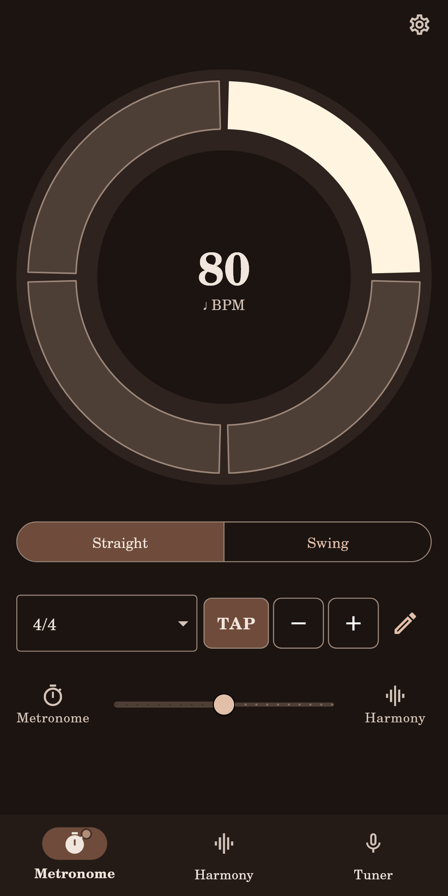
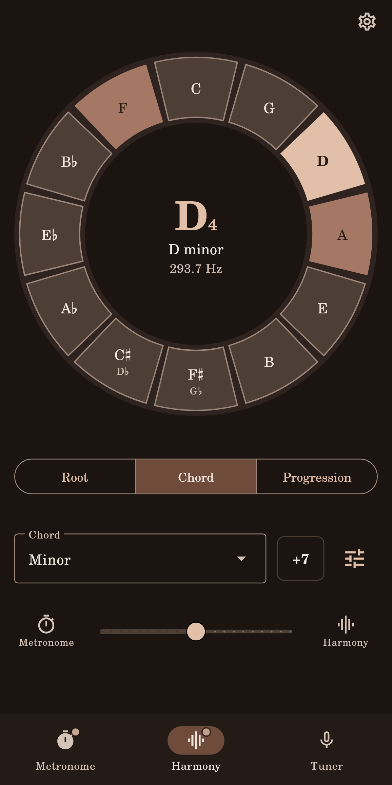
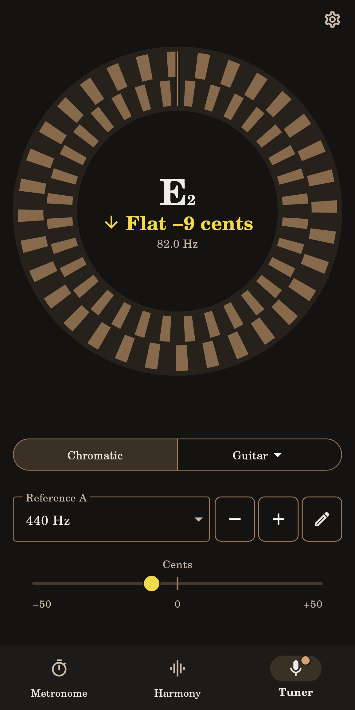

# Low End

Low End is a free, open-source practice app for musicians: a **metronome**, a piano **harmony** section and a **tuner**, in one light Android app, also usable on iPhone as a [web app](docs/web.md). It was made by an amateur double bass player with the friends from the orchestra in mind, and it is useful to everyone who plays. It is built with [Flutter](https://flutter.dev), works fully offline and is available in English and Italian.

<p>
  
  
  
</p>

## What it does

The three tabs are **Metronome**, **Harmony** and **Tuner**, and the app opens on the metronome. The tabs only take you to a section, and so does swiping left and right (in landscape, up and down). Each section starts and stops its own sound from the middle of its dial.

### Metronome

- Tempo from 30 to 250 BPM (up to 400 in 7/8, where it counts eighths): touch the pencil to type it, touch − or + to move by one or hold them to run, or tap TAP. The tempo has its Italian name under it (Andante, Allegro…).
- Time signatures 1/1 (one click a bar), 2/4, 3/4, 4/4, 5/4, 6/8, 7/8, 9/8 and 12/8, with the beats grouped the way you count them.
- A ring that lights up beat by beat (the downbeat marked) and a short, dry woodblock-like click (higher on the downbeat). The second row under the dial (the first is left empty) has two fields: the time signature, and a menu of what fills each beat (quarter notes, eighths, triplets, sixteenths, and swung eighths and sixteenths, played long-short as MuseScore plays "Swing"). The time signature list also has a click on 2 and 4 only. The audio engine loops a whole bar, so the time stays steady.
- Tempo, time signature, subdivision and the click on 2 and 4 are kept for the next launch.

### Harmony

- Twelve note keys round a dial (by fifths or in semitones, as you choose in the settings): touch one to play it on a real piano, in time with the metronome, and touch it again, or the middle of the dial, to stop. Hold C♯ or F♯ to write them D♭ or G♭.
- A **Chord** of eight kinds (major, minor, dominant 7, maj7, m7, half-diminished m7♭5, diminished, sus4), or the note alone (the first entry of the same menu), or a **Progression** of one chord per bar: II–V–I (major and minor, in sevenths), I–IV–V, I–VI–IV–V, I–V–VI–IV, the Andalusian cadence, I–VI–II–V and the twelve-bar blues, in the key of the note touched. The menu names each with a well-known song (Autumn Leaves, Blue Bossa, Twist and Shout, Stand by Me, Sweet Home Chicago). The example songs, a button beside the progression menu, set key, progression and tempo in one tap. The Roman numerals of a progression sit on the keys they stand on; touch one to read what it means.
- Held for the bar, struck on every beat or arpeggiated; the sound options (the button at the end of the row) also offer a held tone instead of the piano. The root is always in octave 3 (A3 = 220 Hz, C3 131 Hz), low enough to sit with a bass, high enough for any instrument and for the phone's own speaker; the rest of the chord sits close together above it, as a pianist's hand plays it. While Harmony sounds, the notes not heard fade on the dial.
- If the metronome is already playing, the harmony comes in on the metronome's next bar line, with a countdown in the middle of the dial; the same goes for the metronome when the harmony is already playing.

### Tuner

- Chromatic, with a round strobe and the note in the middle: play any note and it shows up, no string to choose first.
- Under the strobe, a bar shows how far off the note is: a round marker on a thin track, with a short mark in the middle.
- Finds the note with the YIN algorithm ([`lib/audio/pitch_detector.dart`](lib/audio/pitch_detector.dart)), from 28 to 2800 Hz (700 Hz with the bass chosen): from the lowest strings to the top of the violin and the flute. For B♭, E♭ and F instruments it can name the written note.
- The instrument menu switches from Chromatic to the strings of guitar, violin, viola, cello, ukulele or bass, with the string number shown.
- Reference A under the dial: − and + move by one hertz, the pencil types it or picks 415, 432, 440 or 442 Hz.
- It listens only while it is on screen (and you can pause it from the middle of the dial). Coming to the tuner stops nothing: if the metronome or the harmony is playing, the tuner waits, and touching its dial pauses them (a notice with a **Resume** button brings them back), so the microphone hears only your instrument.

### Settings

The gear in the top corner opens the settings: language (English, Italian, or the phone's), keep the screen on (on by default), note names (Do Re Mi or C D E, or follow the language), reference A (every hertz from 415 to 445), the harmony circle (fifths or semitones), octave numbers (scientific, A4 = 440 Hz, or Italian, La3 = 440 Hz), lock the gestures (turns off only the swipes between sections), how close a note must be to count as in tune (±2, ±5 or ±10 cents) and the transposing instrument of the chromatic tuner. They are kept on the phone. The gesture guide is shown at the first launch and from the settings. The app is always dark; there is no theme to choose.

With the screen off or the app in the background the metronome and the harmony keep playing, with a notification that says what is sounding.

## Free, light and accessible

- **Open source** under the [MIT License](LICENSE). Contributions are welcome: see [CONTRIBUTING.md](CONTRIBUTING.md). The components it uses and their licences are in [THIRD_PARTY_NOTICES.md](THIRD_PARTY_NOTICES.md).
- **Private**: no account, no internet, no ads, no tracking; the microphone is used only while the tuner is on screen. See [PRIVACY.md](PRIVACY.md).
- **Light**: a handful of packages ([flutter_soloud](https://pub.dev/packages/flutter_soloud) for sound, [record](https://pub.dev/packages/record) for the microphone, [audio_service](https://pub.dev/packages/audio_service) for playing with the screen off, plus `shared_preferences`, `wakelock_plus`, `url_launcher` and `intl`), and the audio codecs the app doesn't need are left out of the build.
- **LLM first**: everything on screen is also an action an assistant can call, with a JSON answer, through `lowend://action/...` links. See [docs/llm.md](docs/llm.md).
- **Fast to open**: nothing heavy runs at launch. The audio engine starts only the first time a sound plays and the microphone only after the first frame is drawn (`test/startup_test.dart` checks this), and the launch screen uses the app's own background colour, so there is no white flash.
- **Accessible**: built to follow WCAG 2.1 level AA. Every control has a screen-reader label, the tuner announces the note and whether it is flat, sharp or in tune, colours keep a 3:1 contrast or better and are never the only cue, text can be enlarged, and the strobe stops turning and shows a still marker when the phone asks for fewer animations. `test/accessibility_test.dart` checks this automatically.

## Thanks

To the **Power Flower Orchestra of Fossano**, who inspired this app and put it to the test.

## Ideas for later

Nothing here is promised.

- Metronome: more time signatures, a tempo trainer.
- Harmony: more progressions and chords, just intonation.
- More languages (Spanish, German, French, Portuguese, Japanese).
- A PDF library for sheet music, set lists and annotations, and later PDF to MusicXML and MIDI playback.

## Project structure

```
lib/
  main.dart                 entry point
  actions/                  actions for assistants and automation (docs/llm.md)
  app/                      app setup, navigation, settings, theme, about and guide
  features/
    tuner/                  tuner and harmony (drone/) screens and logic
    metronome/              metronome screen and logic
  audio/                    pitch maths and sound output
  widgets/                  shared UI pieces
  l10n/                     translations (app_en.arb, app_it.arb)
test/                       automated tests (test/review: layouts, languages, text sizes)
test_screenshots/           screenshot harness used to review every screen
tool/                       scripts that make the icons, feature graphics and piano samples
assets/                     piano samples, fonts and the logo
store/                      Google Play listing: texts, graphics, checklist
docs/                       user guide, architecture, style sheet, bronze theme, offline check, assistant actions
```

All colours, shapes and text styles live in `lib/app/theme.dart` (always dark: one bronze accent on ebony, the bronze of the icon; see [docs/tema-bronzo.md](docs/tema-bronzo.md)).

## Run it

With Flutter installed and an Android phone connected (USB debugging on):

```
flutter pub get
flutter run
```

Before opening a pull request run `dart format lib test`, `flutter analyze` and `flutter test`.

To build an APK to share with friends:

```
flutter build apk --release --split-per-abi
```

Send the `arm64-v8a` file: it fits almost every phone from the last ten years. To measure how fast the app opens, run `flutter run --profile --trace-startup`: the times are written to `build/start_up_info.json` (`timeToFirstFrameMicros` is what you feel).

### Web app (iPhone)

The same code also runs in a browser: `.github/workflows/web.yml` publishes it on every push to `main` at https://luigir86.github.io/low-end/. On an iPhone, open it in Safari and choose *Share › Add to Home Screen*. What it can and cannot do there, and how to build it by hand, is in [docs/web.md](docs/web.md).

### Google Play

`flutter build appbundle --release` makes the bundle for the store. It is signed with the upload key named in `android/key.properties` (git-ignored); without that file a release build stops with an error, so nothing is ever signed with the debug key by mistake. The listing texts, graphics and the console checklist are in [store/](store/README.md).

## Translations

Texts live in `lib/l10n/app_en.arb` (English, the reference) and `lib/l10n/app_it.arb` (Italian). After changing them, run `flutter gen-l10n`.

## Documentation

| Document | For |
| --- | --- |
| [docs/user-guide.md](docs/user-guide.md) (English), [docs/manuale-utente.md](docs/manuale-utente.md) (Italiano) | Players: what every control does |
| [docs/architecture.md](docs/architecture.md) | Developers: how the app is built |
| [docs/style.md](docs/style.md), [docs/tema-bronzo.md](docs/tema-bronzo.md) (the second in Italian) | Developers and designers: sizes, shapes and the bronze-on-ebony colours |
| [docs/offline.md](docs/offline.md) | Proof that the app needs no internet, and how to check it |
| [docs/llm.md](docs/llm.md) | Assistants and automation: the `lowend://` actions |
| [docs/web.md](docs/web.md) | The web app for iPhone: installing it, its limits, how it is built |
| [PRIVACY.md](PRIVACY.md) | Privacy policy: no data collected |
| [LICENSE](LICENSE), [THIRD_PARTY_NOTICES.md](THIRD_PARTY_NOTICES.md) | The app's licence and those of everything it uses |
| [store/README.md](store/README.md) | Google Play listing and checklist |
| [CONTRIBUTING.md](CONTRIBUTING.md) | How to help |
